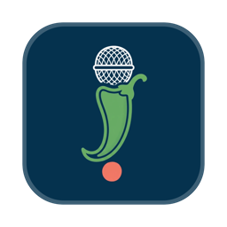

<p align="center">
  
</p>

<h1 align="center">Ole</h1>

<p align="center">
  A live call companion. It listens to the call, and Siesta whispers back.
</p>

<p align="center">
  <a href="https://github.com/coryjett/ole/releases"><b>Download for Mac</b></a> · alpha
</p>

<p align="center">
  <sub>macOS 14.4+ (Apple Silicon) · Siesta key + Solo VPN · OpenAI key (optional)</sub><br><br>
  <a href="#install">Install</a> · <a href="#set-up">Set up</a> · <a href="#privacy">Privacy</a> · <a href="OLE.md">Fork notes</a> · <a href="LICENSE">MIT license</a><br><br>
  A fork of <a href="https://github.com/FrigadeHQ/yogurt">Yogurt</a> by Frigade.
</p>

## What it does

- **Ready before the call.** One click finds your next meeting in Siesta, matches it to an account, and loads what matters: opportunities and their health, the POC tracker, linked GitHub issues and feature requests, recent call briefs, open action items, competitors.
- **Context while you talk.** Short bullets appear as the conversation moves, newest first, each naming its source. When a customer describes a problem, Ole can pull how other customers handled it (anonymised).
- **Calls with no account.** Discovery calls and prospects not in Salesforce yet still get context from Siesta's wider knowledge. Link an account later, or never.
- **Who said what.** Speaker names from Zoom, Teams and Meet.
- **A summary when you hang up.** Discussion, decisions, next steps and open questions, from the transcript and your own notes.
- **A library of every call.** Folders, search, copy and Markdown export.
- **No bot in the meeting.** Ole records from your Mac; nobody sees an extra participant.
- **Your choice of models.** Transcription and summaries run locally on your Mac or on OpenAI with your own key.

## How it works

1. **Prepare.** Before the call, Ole asks Siesta (over MCP) for the account's context once and keeps it.
2. **Listen.** Your microphone and the call audio are recorded as two tracks and transcribed live.
3. **Surface.** Every ~20 seconds of new conversation, the transcript is checked against the prepared context. Siesta is only asked again when something isn't there, a few times a minute at most.
4. **Wrap up.** Recording stops, the summary is written, and the meeting lands in your library with its transcript, bullets and notes.

## Install

1. Download `Ole-mac-arm64.dmg` from the latest pre-release on the [Releases page](https://github.com/coryjett/ole/releases).
2. Drag Ole to Applications.
3. The alpha is not notarized by Apple, so the first open is blocked: open **System Settings > Privacy & Security** and click **Open Anyway** next to Ole.
4. Allow the microphone, call audio and Accessibility when asked. Accessibility is how Ole reads speaker names from Zoom and Teams.

Ole updates itself: new versions download in the background, macOS tells you when one is ready, and **Settings > Updates** restarts into it. Never while you are recording.

## Set up

In **Settings > Ole**:

| Setting | What to put there |
|---|---|
| **Siesta key** | Create one in Siesta under Settings > API Keys. Needs the Solo VPN. |
| **OpenAI key** | A platform key from platform.openai.com. Needed for live bullets, and for OpenAI transcription or summaries. |
| **Transcription** | *Local* (whisper.cpp on your Mac) or *OpenAI*. |
| **Assistant** | *Local* (a model on your Mac) or *OpenAI*. |

Keys are encrypted with the macOS Keychain and only ever shown masked.

## Privacy

- Meetings, transcripts, notes and bullets live on your Mac in `~/Library/Application Support/Ole`.
- With **OpenAI** picked, call audio and transcript text go to OpenAI on your key. With **Local**, they never leave your Mac.
- Siesta gets the meeting and account being prepared, and short search phrases from the conversation when Ole looks for other customers' experience. Ole only reads from Siesta.
- Nobody on the call is told you are recording. Tell them.

<details><summary>FAQ</summary>

**Does it work without Siesta?** Recording, transcripts, summaries and the library work without it (that part is Yogurt). The prepared context and bullets need Siesta.

**Does it work without OpenAI?** Yes, with local models for transcription and summaries. The live bullets need an OpenAI key in the alpha.

**Why does macOS warn me when I open it?** The alpha is signed with Ole's own certificate, not an Apple Developer ID, so Apple hasn't checked it. Updates are signed with the same certificate.

**Windows or Linux?** Not in the alpha.

</details>

## Build from source

Needs Xcode Command Line Tools, cmake, Node and pnpm 10.7.

```bash
npx -y pnpm@10.7.0 install
cd app
npx -y pnpm@10.7.0 typecheck && npx -y pnpm@10.7.0 exec vitest run
npx -y pnpm@10.7.0 dev
```

Releasing, the fork rules and how Yogurt's updates are merged in: [OLE.md](OLE.md).

## License

[MIT](LICENSE). Ole is built on [Yogurt](https://github.com/FrigadeHQ/yogurt), copyright 2026 Frigade. Ole's changes copyright 2026 Cory Jett.
