<p align="center">
  
</p>

<h1 align="center">Ole</h1>

<p align="center">
  Transcribes your calls and enriches them, live, with context from any MCP servers you connect.
</p>

<p align="center">
  <a href="https://github.com/coryjett/ole/releases"><b>Download for Mac</b></a> · alpha
</p>

<p align="center">
  <sub>macOS 14.4+ (Apple Silicon) · MCP server + key · OpenAI key (optional)</sub><br><br>
  <a href="docs/getting-started.md"><b>Getting started</b></a> · <a href="#install">Install</a> · <a href="#set-up">Set up</a> · <a href="#privacy">Privacy</a> · <a href="OLE.md">Fork notes</a> · <a href="LICENSE">MIT license</a><br><br>
  A fork of <a href="https://github.com/FrigadeHQ/yogurt">Yogurt</a> by Frigade.
</p>

<p align="center">
  
</p>

## What it does

Ole brings the right context to a call, from whatever systems know your world. You connect them as MCP servers; Ole only ever reads from them.

| Your calls | Connect | Ole surfaces |
|---|---|---|
| Sales and solutions | a CRM, call recordings, product docs | where the deal stands, what was promised, the answer to a technical question |
| Support and success | a ticketing system, status pages, docs | open tickets, recent incidents, the known fix |
| Recruiting | an applicant tracking system | the candidate's background, feedback so far, what the role needs |
| Engineering and projects | issue trackers, docs, runbooks | the open issue, the design decision, the doc that answers it |
| Research and 1:1s | notes, a wiki, past meetings | what you discussed last time, open questions |

- **Ready before the call.** Ole asks your MCP servers about the meeting, its people and its topic, and writes a short, sourced briefing: the 3 things that matter most, then a few short sections. Add an optional **Focus** (a name or topic) to steer it.
- **Prepared before you remember to.** Ole writes the briefing 5 to 15 minutes before each calendar meeting and tells you when it's ready. A call with a default title ("Meeting") is matched to the calendar event happening now, never a later one.
- **Context while you talk.** Short bullets appear as the conversation moves, newest first, each naming its source. A question from the other side, or a product or name the briefing doesn't mention, gets context within about 10 seconds. When the briefing doesn't cover something, Ole looks it up with the same tools, several lookups at once, a few times a minute at most. A bullet that only rephrases one already shown is dropped.
- **Remembers the whole call.** A running summary of what's been discussed, the notes you type, earlier questions you asked and everything Ole already looked up stay in context for every bullet and answer, not just the last few minutes. The summary updates in the background, so bullets never wait on it.
- **Pin, rate and ask.** Pin a bullet and it lands in your notes and the summary. Thumbs up or down tunes what Ole surfaces on later calls. Type a question mid-call and Ole answers from the briefing, the call and your servers.
- **Docs during the call.** Add a documentation MCP server (for example Context7 at `https://mcp.context7.com/mcp`, no key) and Ole looks up open-source docs in Prepare, live bullets and Ask.
- **Your servers set the role.** A server that publishes an MCP prompt named `prepare_for_meeting` tells Ole which tools to call and what a good briefing looks like for its world. Your own warm-up instructions in Settings refine it. Ole's own rules only cover format, sources and privacy.
- **Careful with names.** Organisations and people your servers mention stay anonymous unless they're part of this meeting, and names never go to a public docs search. When nothing matches the call, bullets stay general.
- **Never caught out by a broken server.** Ole checks your MCP servers in the background and tells you (on Home and with a notification) when one can't be reached or rejects its key, before the call.
- **Hidden while you share, if you like.** Turn it on and, while a call records, Ole's windows stay out of screen sharing (and screenshots; macOS can't tell them apart). A few apps may still show them.
- **Prepare on your Mac if you like.** The briefing can run on the local model instead; live context stays on OpenAI or your own server.
- **Who said what.** Speaker names from Zoom, Teams and Meet.
- **A summary when you hang up.** Discussion, decisions, next steps and open questions, from the transcript and your own notes.
- **A library of every call.** Folders, search, copy and Markdown export.
- **No bot in the meeting.** Ole records from your Mac; nobody sees an extra participant.
- **Your choice of models.** Transcription runs on your Mac or OpenAI; the briefing, bullets and summaries run on OpenAI with your own key or on any OpenAI-compatible server you run, and summaries can also run on your Mac.

## How it works

<p align="center">
  
</p>

1. **Prepare.** Before the call, Ole lists your MCP servers' read-only tools, reads each server's `prepare_for_meeting` prompt if it has one, adds your instructions, and lets the model gather a sourced briefing (up to 10 tool calls).
2. **Listen.** Your microphone and the call audio are recorded as two tracks and transcribed live.
3. **Surface.** About every 45 seconds of new conversation, the transcript is checked against the briefing; within about 10 seconds when the other side asks a question or names something the briefing and the bullets don't mention. The tools are only called again when something isn't there.
4. **Wrap up.** Recording stops, the summary is written, and the meeting lands in your library with its transcript, bullets and notes.

## Install

1. Download `Ole-mac-arm64.dmg` from the latest pre-release on the [Releases page](https://github.com/coryjett/ole/releases).
2. Drag Ole to Applications.
3. The alpha is not notarized by Apple, so the first open is blocked: open **System Settings > Privacy & Security** and click **Open Anyway** next to Ole.
4. Allow the microphone, call audio and Accessibility when asked. Accessibility is how Ole reads speaker names from Zoom and Teams.

Ole updates itself: new versions download in the background, macOS tells you when one is ready, and **Settings > Updates** restarts into it. Never while you are recording.

## Set up

In **Settings > Ole**:

| Setting | What to put there |
|---|---|
| **OpenAI key** | A platform key from platform.openai.com. Needed for the briefing and live bullets, and for OpenAI transcription or summaries. |
| **MCP servers** | Add each server's name, URL (https, usually ending in `/mcp`) and key, then **Test** to see how many read-only tools Ole can use. |
| **Warm-up instructions** | Optional. How you want Ole to prepare, e.g. "Look up the customer's open tickets and last incident; lead with anything overdue." or "Pull the candidate's profile and interview feedback; list what's still unknown." |
| **Transcription** | *Local* (whisper.cpp on your Mac) or *OpenAI*. |
| **Assistant** | *Local* (a model on your Mac, summaries only), *OpenAI*, or *Custom server*: any OpenAI-compatible server you run (address ending at `/v1`, optional key, model). Prepare and live context need OpenAI or a Custom server. |

Keys are encrypted with the macOS Keychain and only ever shown masked.

## Privacy

- Meetings, transcripts, notes and bullets live on your Mac in `~/Library/Application Support/Ole`.
- With **OpenAI** picked, call audio and transcript text go to OpenAI on your key. With **Local**, they never leave your Mac.
- Your MCP servers get the tool calls the model makes: the meeting title, your focus, and short search phrases from the conversation. Ole only calls tools that read.
- Nobody on the call is told you are recording. Tell them.

<details><summary>FAQ</summary>

**Does it work without an MCP server?** Recording, transcripts, summaries and the library work without one (that part is Yogurt). The prepared context and bullets need it.

**Does it work without OpenAI?** Yes, with local models for transcription and summaries. The briefing and live bullets need an OpenAI key in the alpha.

**How does Ole decide a tool only reads?** The server marks it read-only, or its name starts with get_, list_, search_, find_, read_, query_, fetch_, lookup_ or describe_ and it isn't marked destructive.

**Why does macOS warn me when I open it?** The alpha is signed with Ole's own certificate, not an Apple Developer ID, so Apple hasn't checked it. Updates are signed with the same certificate.

**Windows or Linux?** Not in the alpha.

</details>

## Build from source

Needs Xcode Command Line Tools, cmake, Node and pnpm 10.7.

```bash
npx -y pnpm@10.7.0 install
cd app
npx -y pnpm@10.7.0 typecheck && npx -y pnpm@10.7.0 exec vitest run
npx -y pnpm@10.7.0 dev
```

Releasing, the fork rules and how Yogurt's updates are merged in: [OLE.md](OLE.md).

## License

[MIT](LICENSE). Ole is built on [Yogurt](https://github.com/FrigadeHQ/yogurt), copyright 2026 Frigade. Ole's changes copyright 2026 the Ole contributors.
